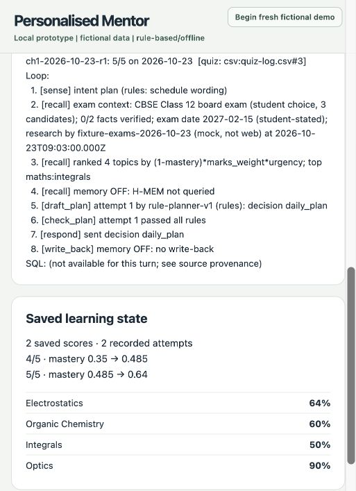

# Personalised Mentor: actual examples and evidence

All students and records below are fictional. Execution dates differ from the fixed simulated study date 2026-10-23. No example establishes real-student efficacy, official exam guidance or full live-model acceptance.

| Sample | Actual input | Actual output / provenance |
|---|---|---|
| Typed browser journey, Oct 28 | [Recording inputs](recording.md) | [Complete server-written transcript](evidence/recording-20261028/final-transcript.txt). 4/5, no duplicate, then 5/5; two saved attempts and Integrals first. Both quizzes ran with memory off. Later plan-summary forgetting preserves scores. |
| Persisted browser results, same run | The two completed quizzes in that transcript | [Two attempts](evidence/recording-20261028/final-quiz-attempts.jsonl), [score CSV](evidence/recording-20261028/final-quiz-log.csv), [mastery CSV](evidence/recording-20261028/final-study-records.csv), [selected actual checkpoints](evidence/browser-checkpoints.json). These are stored execution results, not expected fixtures. |
| Unsupported browser case, Oct 28 | `Martian Entrance Exam`, `India`, `90%`, `15 Feb 2027`, `continue without research`, `quiz me` | [Actual refusal/no-notes output](evidence/recording-20261028/unsupported-transcript.txt). No fabricated research or quiz result. |
| Earlier scripted CLI journey/controls, Oct 27 | [CLI input](../../scripts/quiz-conversation.txt), [extended controls input](evidence/controls-input.txt) | [Actual CLI output](evidence/chat-actual.txt), [memory controls output](evidence/controls-actual.txt), [journey script output](evidence/journey-actual.txt), [dated commands/exits](evidence/runs.json). The cancelled quiz/retake and memory-on defaults differ from the browser run. |
| Stored regression example | Intake/initial plan in the CLI test | [Golden expected output](../../test/fixtures/chat-default.golden.txt). STORED EXPECTED OFFLINE OUTPUT; not a fresh run or proof of two attempts. |
| Historical live data checks | Earlier live-loop requests, not rerun here | [Allowlisted historical summary](evidence/historical-live-summary.json). Zetaris-read checks, one model request each, both loops failed. This is not the missing standalone four-row/zero-model-call receipt; that receipt was not found or fabricated. |

The screenshot was visually inspected and contains the prototype label and fictional state, without desktop/private-app inventory. The [public evidence hashes](evidence/public-sha256.json) cover only the selected existing files and checkpoint extract. Original unselected snapshots, browser automation inventories, raw provider receipts, internal release notes and private reports are excluded from the proposed public manifest.
